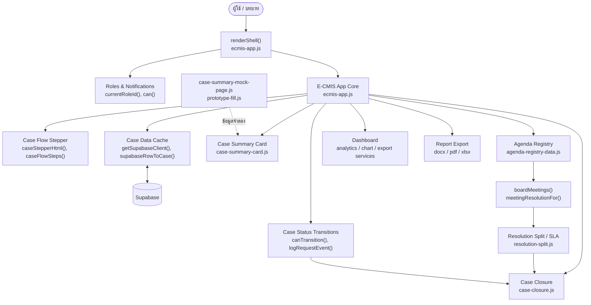
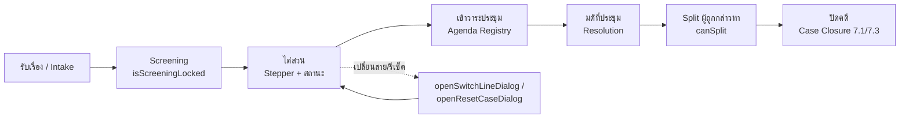
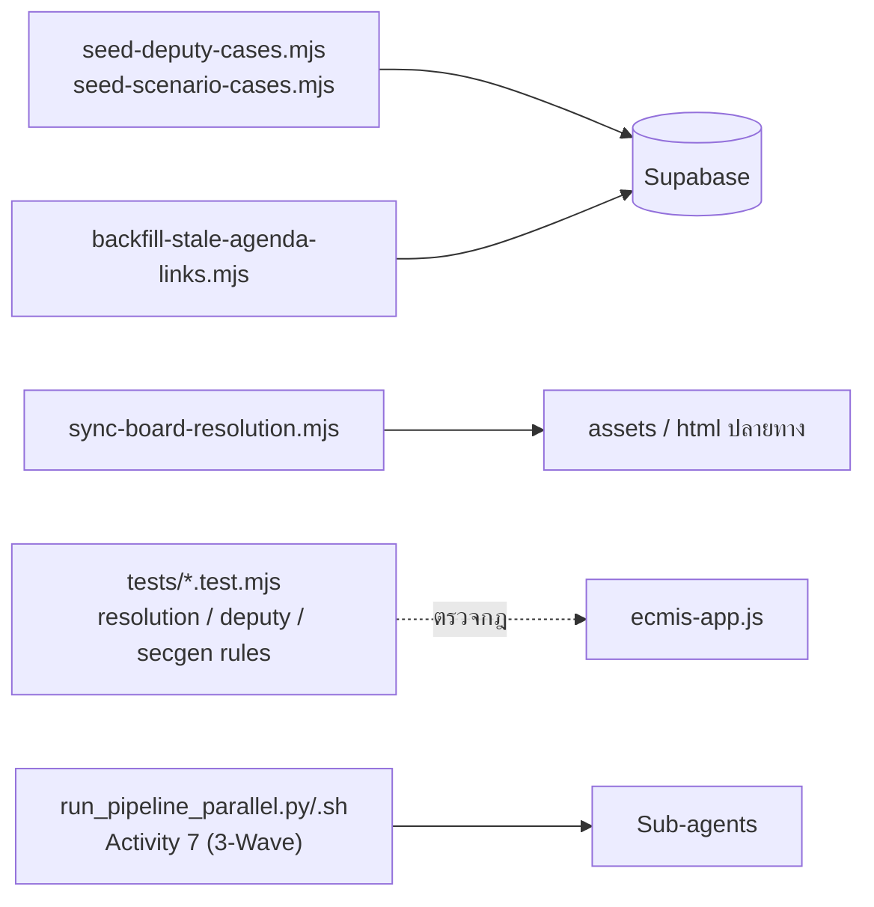

# Flow ของโปรเจกต์ E-CMIS (สร้างจาก graphify)

> สร้างจากกราฟ `graphify-out/graph.json` (เฉพาะโค้ด 29 ไฟล์) — แสดงโมดูลและการไหลของข้อมูลหลัก
> ความสัมพันธ์บางเส้นเป็น INFERRED ควรตรวจกับโค้ดจริงก่อนใช้อ้างอิง

## 1) ภาพรวมโมดูล (Module Flow)

## 2) Flow ของคดี (Case lifecycle) ตามที่กราฟชี้

## 3) Flow ของเครื่องมือ/สคริปต์

