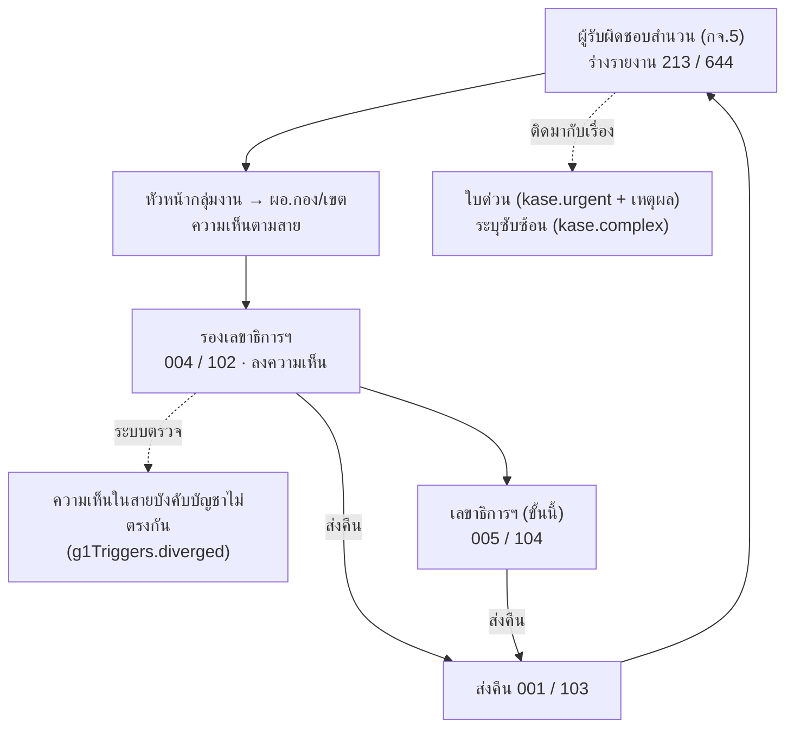
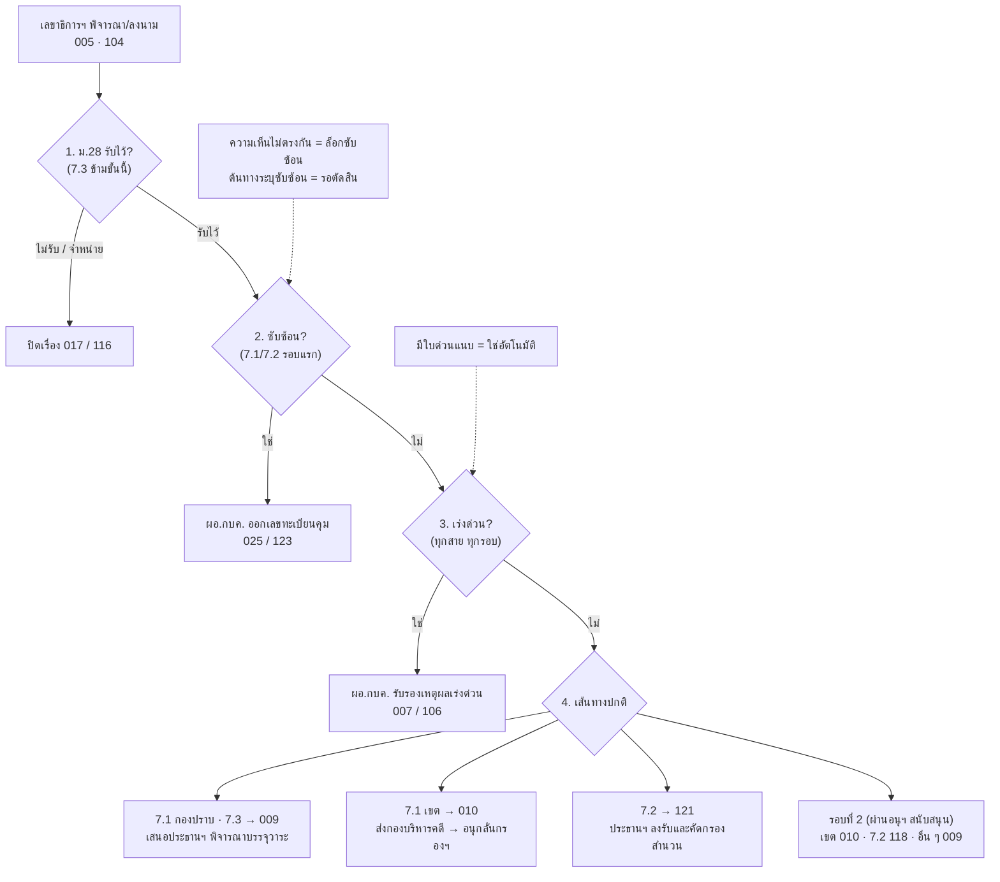
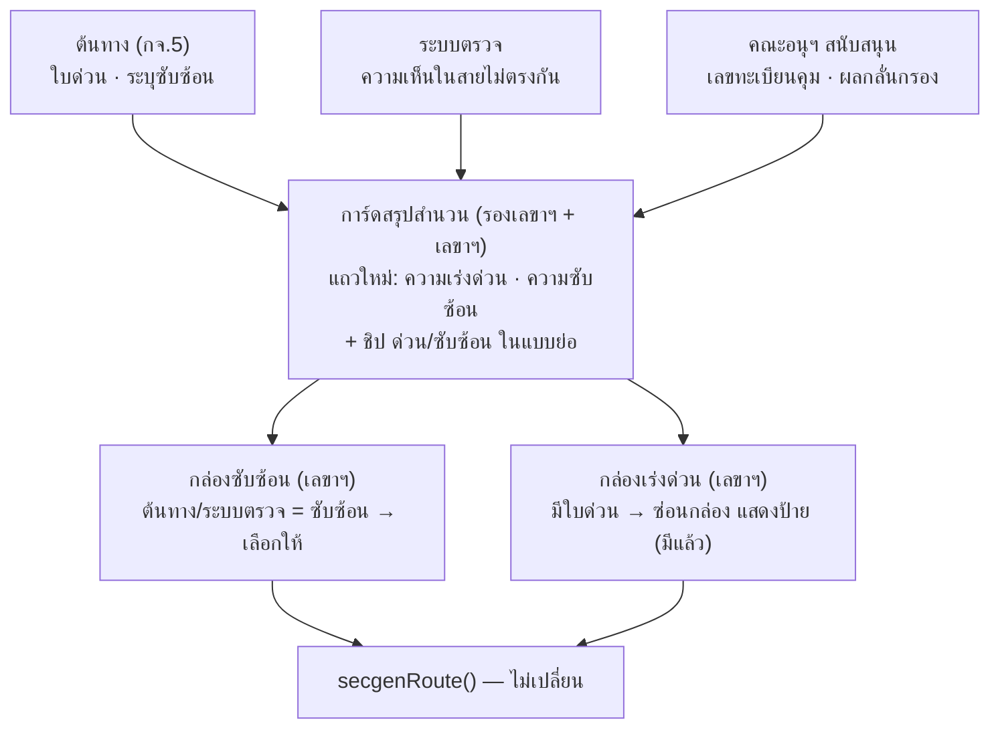

# กล่อง "ซับซ้อนหรือไม่" และ "เร่งด่วนหรือไม่" — หน้าเลขาธิการฯ พิจารณา/ลงนาม (กิจกรรม 7)

- **หน้าจอ:** `approval-review.html` (ฟังก์ชัน `initReport213Screen`) และ `review.html`
- **บทบาท:** เลขาธิการฯ (secgen) ที่สถานะ `PENDING_SECGEN` (005) และ `PENDING_SECGEN_72` (104)
- **อ้างอิง:** A7-11 ในไฟล์ Excel รายการปรับแก้ mockup กจ.7
- **วันที่สรุป:** 22 ต.ค. 2569
- **สถานะ:** แก้ข้อความและการแสดงผลแล้ว ยังไม่ commit (โฟลเดอร์นี้ไม่ใช่ git repo) · มีเรื่องรอตัดสิน 3 ข้อ (หัวข้อ 9)

---

## 1. ขอบเขตและข้อห้าม

- แก้ได้เฉพาะข้อความ การแสดง/ซ่อนกล่อง และข้อความสรุปเส้นทาง
- **ห้ามแก้** `TRANSITIONS`, `STATUS_CODE`, guard และลำดับการตัดสินเส้นทางใน `save_status`
- ถ้าพบข้อความไม่ตรงกับเส้นทางจริง ให้รายงาน ห้ามแก้ logic เอง
- ห้ามสร้างข้อมูลตัวอย่างเอง

---

## 2. Flow ก่อนถึงเลขาธิการฯ

ข้อมูลที่มีผลต่อกล่องเร่งด่วน/ซับซ้อนเกิดขึ้นตั้งแต่ต้นทาง

---

## 3. Flow การตัดสินของเลขาธิการฯ (`secgenRoute()`)

ระบบตรวจทีละข้อจากบนลงล่าง ข้อแรกที่ได้ "ใช่" เป็นตัวกำหนดปลายทาง

**ลำดับความสำคัญ:** ม.28 → ซับซ้อน → เร่งด่วน → ผ่านคณะอนุฯ สนับสนุนแล้ว → ปกติ

| ซับซ้อน | ด่วน | ประเภท | สถานะถัดไป | ข้อความสรุปเส้นทาง |
|---|---|---|---|---|
| ใช่ | ใด ๆ | 7.1 / 7.2 | 025 / 123 | ส่ง ผอ.กบค. ออกเลขทะเบียนคุม → คณะอนุฯ สนับสนุน → กลับเลขาธิการฯ |
| ไม่ | ใช่ | 7.1 / 7.2 / 7.3 | 007 / 106 / 007 | ส่ง ผอ.กบค. รับรองเหตุผลเร่งด่วน → เลขาธิการฯ ยืนยัน → ประธานฯ บรรจุวาระด่วน |
| ไม่ | ไม่ | 7.1 กองปราบ | 009 | เสนอประธานกรรมการ ป.ป.ท. พิจารณาบรรจุวาระ |
| ไม่ | ไม่ | 7.1 เขต | 010 | ส่งกองบริหารคดี → คณะอนุกลั่นกรองฯ → ประธานฯ ลงนามบรรจุวาระ |
| ไม่ | ไม่ | 7.2 | 121 | เสนอประธานฯ ลงรับและคัดกรองสำนวน |
| – | ไม่ | 7.3 | 009 | เสนอประธานกรรมการ ป.ป.ท. พิจารณาบรรจุวาระ |
| – | – | ม.28 ไม่รับ / จำหน่าย | 017 / 116 | ปิดเรื่องตามคำสั่ง ม.28 |

---

## 4. Flow หลังเลขาธิการฯ ลงนาม

| ปลายทาง | ขั้นตอนถัดไป |
|---|---|
| **ซับซ้อน** 025 / 123 | ผอ.กบค. ออกเลขทะเบียนคุม (ทค.N/ปี) + มอบหมายคณะ 1/2 → คณะอนุฯ สนับสนุนให้ความเห็น → กลับเลขาฯ รอบที่ 2 |
| **เร่งด่วน** 007 / 106 | ผอ.กบค. รับรอง → เลขาฯ ยืนยัน → ประธานฯ บรรจุวาระด่วน · ถ้าไม่รับรอง: 7.1 เข้าอนุกลั่นกรองฯ / 7.2 กลับเลขาฯ / 7.3 ประธานฯ ปกติ |
| **ประธานฯ** 009 (7.1 กองปราบ · 7.3) | ประธานฯ สั่งการ → 7.1 อนุกลั่นกรองฯ 1–8 → ลงนามบรรจุวาระ · 7.3 บรรจุวาระทันที |
| **กองบริหารคดี** 010 (7.1 เขต) | กำหนดคณะอนุกลั่นกรองฯ 1–8 → อนุกลั่นกรองฯ → ประธานฯ ลงนามบรรจุวาระ (ไม่ผ่านประธานฯ ก่อน) |
| **ประธานฯ ลงรับ** 121 (7.2) | ประธานฯ คัดกรองความยุ่งยากอีกชั้น: ยุ่งยาก → อนุกลั่นกรองฯ · ไม่ยุ่งยาก → กลุ่มงานกิจการฯ ทำความเห็น → ลงนามบรรจุวาระ |
| **ปิดเรื่อง ม.28** 017 / 116 | จบเรื่อง รายงานคณะกรรมการ ป.ป.ท. ในรอบถัดไปอัตโนมัติ |
| **ส่งคืน** 001 / 103 | ผู้รับผิดชอบสำนวนแก้ไข → เสนอใหม่ตามสาย → รองเลขาฯ → เลขาฯ |

> 7.2 มีคำว่า "ซับซ้อน" 2 ความหมาย: ที่เลขาฯ ชี้ = ส่งคณะอนุฯ **สนับสนุน** · ที่ประธานฯ ชี้ที่ 121 = ส่งคณะอนุ**กลั่นกรอง** หรือให้กลุ่มงานกิจการฯ ทำความเห็น

---

## 5. กล่อง "เป็นกรณีซับซ้อนหรือไม่?" (`#g1Box`)

> หน้าจอเลขาฯ จัดเป็น 2 กล่องแยกกัน (radio คนละกลุ่ม): **กล่องเร่งด่วนอยู่บน กล่องซับซ้อนอยู่ล่าง** แต่ลำดับการพิจารณาและส่งต่อยังเป็นของ `secgenRoute()` เดิม (ซับซ้อน > เร่งด่วน)

**แสดงเมื่อครบทุกข้อ** (`g1BoxVisible()`):
- login เป็นเลขาธิการฯ
- เรื่องสาย 7.1 หรือ 7.2 (ไม่ใช่ 7.3)
- คำสั่ง ม.28 = รับไว้
- ยังไม่ผ่านคณะอนุฯ สนับสนุน (ไม่มี `supportOpinion` / `supportOpinion72` / `supportDecision`)

**ข้อความตัวเลือก "ไม่ซับซ้อน" (`#g1no`):**

| กรณี | ข้อความ |
|---|---|
| 7.1 กองปราบ (ownerOrg ไม่มีคำว่า "เขต") | ไม่ซับซ้อน — เสนอประธานกรรมการ ป.ป.ท. พิจารณาบรรจุวาระ |
| 7.1 เขต | ไม่ซับซ้อน — ส่งกองบริหารคดีเพื่อส่งเข้าคณะอนุกลั่นกรองฯ |
| 7.2 | ไม่ซับซ้อน — เสนอประธานกรรมการ ป.ป.ท. ลงรับและคัดกรองสำนวน |

**ตัวเลือก "ซับซ้อน" (`#g1yes`):** "ซับซ้อน — ส่ง ผอ.กบค. ออกเลขทะเบียนคุม / มอบหมายคณะอนุสนับสนุนฯ"
- แสดง `#complexReasonBox` (บังคับกรอก) ซ่อน `#myOpinionBox`
- ปุ่มหลักเป็น "ส่ง ผอ.กบค. ออกเลขทะเบียนคุม"

**ความเห็นในสายบังคับบัญชาไม่ตรงกัน** (`g1Triggers(kase).diverged`): ระบบเลือกซับซ้อน ปิดตัวเลือกไม่ซับซ้อน และแสดง "ความเห็นในสายบังคับบัญชาไม่ตรงกัน (ระบบตรวจ)"

**รอบที่ 2** (คณะอนุฯ สนับสนุนส่งความเห็นกลับแล้ว):
- ซ่อนกล่องซับซ้อน แสดงการ์ดผลการกลั่นกรองของคณะอนุฯ สนับสนุนแทน
- ช่องความเห็นชื่อ "ความเห็นของเลขาธิการ ป.ป.ท." พร้อมข้อความตั้งต้นที่แก้ได้
- ปุ่ม: สำนวนเขต "ลงนามดิจิทัลและส่งกองบริหารคดี" · กรณีอื่น "ลงนามดิจิทัลและเสนอประธานฯ"

---

## 6. กล่อง "เป็นกรณีเร่งด่วนหรือไม่?" (`#urgentBox72`)

- แสดงสำหรับเลขาธิการฯ ทั้ง 7.1, 7.2 และ 7.3 ทุกรอบ
- **ตัวเลือก:** `#urgentNo72` "ไม่เร่งด่วน" · `#urgentYes72` "เร่งด่วน" (ปลายทางอ่านได้จากข้อความ "เส้นทางเมื่อลงนาม" ใต้กล่อง)
- **มีใบด่วนแนบจากต้นทาง (`kase.urgent = true`):** ซ่อนกล่อง แสดงป้าย "มีใบด่วนแนบ: <เหตุผล>" ในตำแหน่งเดิม (`#urgentPreBadge`) ถือว่าเลือกเร่งด่วนแล้ว
- เลขาธิการฯ ไม่ต้องกรอกเหตุผลเร่งด่วน (ผอ.กบค. เป็นผู้เขียนตอนรับรอง) `#urgentReasonBox72` ซ่อนเสมอ
- เลือกเร่งด่วนแล้ว ข้อความสรุปเส้นทางและปุ่มเปลี่ยนเป็นเส้นทาง ผอ.กบค. ทันที

---

## 7. ข้อความสรุปเส้นทาง (`#g1Outcome`) และป้ายปุ่ม

ทั้งสองอย่างอ่านปลายทางจาก `secgenRoute()` ตัวเดียวกับที่ `save_status` ใช้ ผ่านตาราง `SECGEN_ROUTE_TEXT` จึงตรงกับสถานะที่บันทึกจริงเสมอ

| สถานะปลายทาง | ข้อความสรุป | ปุ่มลงนาม |
|---|---|---|
| 025 / 123 | ส่ง ผอ.กบค. ออกเลขทะเบียนคุม → คณะอนุฯ สนับสนุน → กลับเลขาธิการฯ | ส่ง ผอ.กบค. ออกเลขทะเบียนคุม |
| 007 / 106 | ส่ง ผอ.กบค. รับรองเหตุผลเร่งด่วน → เลขาธิการฯ ยืนยัน → ประธานฯ บรรจุวาระด่วน | ลงนามดิจิทัลและส่ง ผอ.กบค. รับรองเหตุผลเร่งด่วน |
| 009 / 118 | เสนอประธานกรรมการ ป.ป.ท. พิจารณาบรรจุวาระ | ลงนามดิจิทัลและเสนอประธานฯ |
| 010 | ส่งกองบริหารคดี → คณะอนุกลั่นกรองฯ → ประธานฯ ลงนามบรรจุวาระ | ลงนามดิจิทัลและส่งกองบริหารคดี |
| 121 | เสนอประธานฯ ลงรับและคัดกรองสำนวน | ลงนามดิจิทัลและเสนอประธานฯ ลงรับและคัดกรองสำนวน |
| 017 / 116 | ปิดเรื่องตามคำสั่ง ม.28 — <คำสั่ง> | ลงนามคำสั่งไม่รับเรื่องไว้พิจารณา / ลงนามคำสั่งจำหน่ายเรื่อง |

---

## 8. สิ่งที่แก้แล้ว

**approval-review.html**
- เพิ่มกล่อง `#g1Outcome` (เดิมไม่มี element นี้ ฟังก์ชันสรุปเส้นทางจึงไม่เคยแสดงผล)
- ย้าย `secgenRoute()` ออกจาก `handle()` มาระดับหน้าจอ **โดยไม่แก้โค้ด** (ตรวจแล้วเหมือนเดิมทุกบรรทัด ต่างแค่ย่อหน้า)
- กล่องซับซ้อนใช้กฎเดียว `g1BoxVisible()` (เดิมสลับ ม.28 กลับเป็น "รับไว้" แล้วกล่องโผล่ในเรื่อง 7.3 และรอบที่ 2)
- บังคับซับซ้อนเมื่อความเห็นในสายไม่ตรงกัน · ข้อความตัวเลือก "ไม่ซับซ้อน" ของ 7.2
- ข้อความตัวเลือกเร่งด่วน · ป้าย "มีใบด่วนแนบ"
- ป้ายปุ่มลงนามและข้อความสรุปจาก `SECGEN_ROUTE_TEXT`

**review.html** — แก้แบบเดียวกัน ข้อความสรุปและปุ่มอ่านจาก `secgenRoute()` ของไฟล์ตัวเอง (ตรรกะต่างจาก approval-review ดูหัวข้อ 10)

**Diff:** `secgen-g1-urgent.diff` (ย้ายไป `docs/_to_delete/28102026/` เมื่อ 28 ต.ค. 2569 — โค้ดรวมเข้า approval-review.html แล้ว)

---

## 9. เรื่องที่รอตัดสิน

### 9.1 ค่าซับซ้อนจากต้นทาง (`kase.complex`) — ล็อกไว้ หรือให้เลขาฯ เปลี่ยนได้

ตอนนี้หน้าจอไม่ได้ใช้ค่านี้เลย กล่องยังเลือก "ไม่ซับซ้อน" ไว้ก่อน ซึ่งขัดกับกติกาใน `ecmis-app.js`

**ทำไมต้องถาม:** กติกาสองชุดขัดกัน
- `g1Triggers()` และ TRANSITIONS ถือว่าเรื่องที่ต้นทางระบุซับซ้อน **ต้อง** ส่งเป็นเรื่องซับซ้อน (guard ของ `SIGN_NORMAL` กำหนด `!g1Triggers(k).required`)
- ป้ายกล่องเขียน "(ดุลพินิจเลขาธิการฯ)" และคอมเมนต์ใน TRANSITIONS ระบุว่าอำนาจวินิจฉัยความซับซ้อนเป็นของเลขาธิการฯ ตาม ม.24 วรรคสาม

| | ล็อกไว้ (แนะนำ) | ให้เลขาฯ เปลี่ยนได้ |
|---|---|---|
| เลขาฯ เห็นด้วยว่าซับซ้อน | ผอ.กบค. → คณะอนุฯ สนับสนุน → กลับเลขาฯ รอบ 2 | เหมือนกัน |
| เลขาฯ เห็นว่าไม่ซับซ้อน | ใช้ปุ่ม "ส่งคืนผู้รับผิดชอบสำนวน" ให้ต้นทางแก้การระบุ | ลงเส้นทางปกติทันที แต่ TRANSITIONS ไม่รองรับ |
| เรื่อง 7.2 | ผ่านการกรองความยุ่งยาก 2 ชั้น | ยังมีประธานฯ คัดกรองที่ 121 รองรับ |
| ต้องแก้ logic | ไม่ต้อง | ต้องแก้ `g1Triggers()` และ guard ของ TRANSITIONS |

**ข้อแนะนำ: ล็อกไว้** เพราะ
1. ตรงกับกติกาที่ระบบมีอยู่แล้ว
2. ไม่ต้องแก้ logic ตามข้อห้าม
3. เลขาฯ ยังมีทางออกคือ "ส่งคืน" ข้อมูลถูกแก้ที่ต้นทางพร้อมบันทึก
4. ข้อมูลที่บังคับความซับซ้อนทุกแบบล็อกเหมือนกัน ผู้ใช้ไม่ต้องจำข้อยกเว้น

ใต้กล่องจะแสดงเหตุผล เช่น "ต้นทางระบุว่าเป็นเรื่องซับซ้อน — หากไม่เห็นด้วย ให้ส่งคืนผู้รับผิดชอบสำนวน"

### 9.2 ค่าเริ่มต้นของกล่องซับซ้อน
ให้เลือก "ไม่ซับซ้อน" ไว้ก่อนเหมือนตอนนี้ หรือไม่เลือกอะไรแล้วบังคับให้เลขาฯ เลือกเอง

### 9.3 กล่อง ม.28 ของเรื่อง 7.2
ตอนนี้แสดงอยู่ ต้องการให้แสดงต่อหรือไม่

---

## 10. จุดที่ข้อความไม่ตรงกับ logic (รายงาน ไม่ได้แก้ logic)

1. **review.html ตรรกะเส้นทางต่างจาก approval-review**
   - เรื่องด่วนไปเข้าคิวประธานฯ ทันที (009 แทน 007) — `review.html:653`
   - ไม่มีสายเขต (010) และไม่มีเส้นทาง 7.2 → 121 — `review.html:657`
   - การบันทึกบังคับกรอกเหตุผลเร่งด่วน — `review.html:1091` จึงซ่อนช่องเหตุผลไม่ได้
   - แสดงกล่อง ม.28 กับเรื่อง 7.3 — `review.html:532`
   - ป้าย "เร่งด่วน — ส่ง ผอ.กบค. รับรองเหตุผล" ตามสเปกจึงไม่ตรงกับเส้นทางจริงของไฟล์นี้
2. **ผู้ลงนามในกล่องลงนามสองคนผิดคน** — ใช้ "นางสาวกรรณิกา วงศ์ศิริ" (case_admin) แทน ผอ.กบค. นายบุญลือ สุขเกษม — `approval-review.html:1793` และกล่องนี้เปิดเฉพาะเรื่องที่มีใบด่วนแนบจากต้นทาง ถ้าเลขาฯ เลือกเร่งด่วนเองจะไม่เปิด — `approval-review.html:1790`
3. **หน้าจอชี้มูล (7.2 ประเภท RULING)** — `renderRouteOutcome` เขียนว่าเรื่องไม่ซับซ้อนไม่ด่วน "เข้าคณะอนุกรรมการกลั่นกรอง" แต่ TRANSITIONS ส่งไป 121 — `approval-review.html:1972` (กล่องนี้ยังซ่อนอยู่ในหน้าจอนั้น)
4. **TRANSITIONS ไม่มีเส้นทางที่ save_status ใช้จริง** — 005 → 010 (เขต), 005/104 → ปิดเรื่องตาม ม.28, 104 → 118 (7.2 รอบที่ 2) — `assets/ecmis-app.js:279-404` การบันทึกยังทำงานเพราะไม่ได้ตรวจผ่าน `canTransition`
5. **ค่าซับซ้อนจากต้นทางไม่ถูกใช้** — `kase.complex` (คอลัมน์ `tcc_complex`) ไม่ถูกอ่านในหน้าจอเลย (หัวข้อ 9.1)

---

## 11. ผลตรวจ (ดักการเขียน Supabase ไว้ ข้อมูลจริงไม่ถูกเปลี่ยน)

| กรณี | กล่องที่เห็น | ข้อความสรุป / ปุ่ม | สถานะที่ได้ | ผล |
|---|---|---|---|---|
| 7.1 เขต 9205/2569 · ไม่ซับซ้อน ไม่ด่วน | ซับซ้อน + เร่งด่วน | ส่งกองบริหารคดี → … / "ลงนามดิจิทัลและส่งกองบริหารคดี" | 010 | ผ่าน |
| 9205 · ไม่ซับซ้อน + ด่วน | เหมือนแถวบน | ส่ง ผอ.กบค. รับรองเหตุผลเร่งด่วน → … | 007 | ผ่าน |
| 9205 · ซับซ้อน | ช่องเหตุผลซับซ้อน แสดง · ช่องความเห็น ซ่อน | ส่ง ผอ.กบค. ออกเลขทะเบียนคุม → … | 025 | ผ่าน |
| 9205 · ม.28 ไม่รับ / จำหน่าย | กล่องซับซ้อนซ่อน | "ลงนามคำสั่งไม่รับ… / จำหน่าย…" | 017 | ผ่าน |
| รอบที่ 2: 9207/2569 (เขต) | ไม่มีกล่องซับซ้อน · "ความเห็นของเลขาธิการ ป.ป.ท." | "ลงนามดิจิทัลและส่งกองบริหารคดี" | 010 | ผ่าน |
| 7.3: 9409/2569 | ไม่มี ม.28 / ไม่มีกล่องซับซ้อน / มีกล่องเร่งด่วน | เสนอประธานฯ พิจารณาบรรจุวาระ | 009 (ด่วน 007) | ผ่าน |
| review.html: 9205 / 9207 / 9409 | กล่องแสดงตามกฎเดียวกัน | ข้อความตรงกับตรรกะของไฟล์เอง | 009 | ข้อความผ่าน · ตรรกะไม่ตรงตาราง |

**ไม่มีข้อมูลตัวอย่างให้ทดสอบ:** 7.1 กองปราบที่สถานะ 005 · 7.2 ที่เปิดหน้าจอ 213 (เรื่องที่ 104 ทุกเรื่องเป็นประเภท RULING) · เรื่องที่มีใบด่วนแนบ · เรื่องที่ความเห็นในสายไม่ตรงกัน

---

## 12. ข้อเสนอ: แสดงความเร่งด่วนและความซับซ้อนในการ์ดสรุปสำนวน (ยังไม่ได้ทำ)

ตอนนี้ความเร่งด่วนและความซับซ้อนเลือกได้เฉพาะในการ์ดความเห็นของเลขาฯ การ์ดสรุปสำนวน หัวหน้าจอ และ inbox ไม่แสดงเลย (inbox มีแค่ป้าย "ด่วน" ต่อท้ายเลขสำนวน) รองเลขาฯ จึงไม่เห็นข้อมูลนี้ในหน้าจอ

**แถว "ความเร่งด่วน"** (ทุกสาย)

| ข้อมูลที่มี | ข้อความ |
|---|---|
| มีใบด่วนแนบจากต้นทาง | **ด่วน** — มีใบด่วนแนบ: <เหตุผล> |
| ไม่มีใบด่วนแนบ | ไม่มีใบด่วนแนบ (เลขาธิการฯ พิจารณาความเร่งด่วนได้ในขั้นลงนาม) |
| ผ่าน ผอ.กบค. รับรองแล้ว | **ด่วน** — ผอ.กบค. รับรองเหตุผลแล้ว |

**แถว "ความซับซ้อน"**

| ข้อมูลที่มี | ข้อความ |
|---|---|
| เรื่อง 7.3 | ไม่เกี่ยวข้อง |
| ต้นทางระบุซับซ้อน | **ซับซ้อน** — ต้นทางระบุ |
| ความเห็นในสายไม่ตรงกัน | **ซับซ้อน** — ความเห็นในสายบังคับบัญชาไม่ตรงกัน (ระบบตรวจ) |
| ผ่านคณะอนุฯ สนับสนุนแล้ว | **ซับซ้อน** — ผ่านคณะอนุฯ สนับสนุนแล้ว (ทค.N/ปี · คณะที่ X) |
| ไม่มีข้อมูลข้างต้น | ยังไม่ได้ชี้ — เลขาธิการฯ เป็นผู้พิจารณา |

- หน้า Mock ทั้ง 6 หน้าเพิ่มแถวเดียวกัน (สถานะ "ข้อมูลครบ" มีตัวอย่างทั้งด่วนและซับซ้อน)
- รองเลขาฯ เห็นสองแถวนี้แต่ไม่มีกล่องให้เลือก (ไม่มีอำนาจชี้ซับซ้อน/เร่งด่วนตามบทบาท)
- ลำดับการตัดสินเส้นทางไม่เปลี่ยน

---

## 13. หน้าจอ Mock ตัวอย่างการ์ดความเห็นของเลขาฯ (ข้อมูลจำลอง)

ทุกหน้า Mock มีการ์ด "ความเห็นของผู้พิจารณาชั้นนี้" ใต้การ์ดสรุปสำนวน (สลับมุมมองเป็นเลขาธิการฯ เพื่อดูกล่อง · มุมมองรองเลขาฯ ไม่มีตัวเลือก)
ปุ่มลงนามในหน้า Mock ไม่บันทึกจริง แสดงเฉพาะ "สถานะถัดไป" ที่หน้าจริงจะส่งต่อ

| ตัวอย่าง | หน้า | เลขสำนวน Mock | อ้างอิงเดิม | กล่องที่เห็น | สถานะถัดไป (ปกติ / ด่วน / ซับซ้อน) |
|---|---|---|---|---|---|
| 7.1 กองปราบ | approval-review-mock-07.html | 9945/2569 | 1420/2569 | เร่งด่วน + ซับซ้อน | 009 / 007 / 025 |
| 7.1 เขต | approval-review-mock-04.html | 9944/2569 | 9207/2569 | เร่งด่วน + ซับซ้อน | 010 / 007 / 025 |
| 7.2 | approval-review-mock-06.html | 1466/2566 | 1177/2566 | เร่งด่วน + ซับซ้อน | 121 / 106 / 123 |
| 7.3 | approval-review-mock-02.html | 9943/2569 | 9409/2569 | เร่งด่วน | 009 / 007 / — |
| มีใบด่วนแนบ | approval-review-mock-08.html | 9946/2569 | 9202/2569 | ป้ายใบด่วน + ซับซ้อน | 007 (ด่วนอัตโนมัติ) / — / 025 |
| ความเห็นไม่ตรงกัน | approval-review-mock-09.html | 9947/2569 | 9204/2569 | เร่งด่วน + ซับซ้อน (ล็อก) | 123 ทุกกรณี |
| รอบที่ 2 | approval-review-mock-10.html | 9944/2569 (สถานะถัดไปของเคสเดิม) | 9207/2569 | ผลกลั่นกรองอนุฯ สนับสนุน + เร่งด่วน | 010 / 007 / — |

- เลขสำนวน 9945–9947/2569 รันต่อจากเลขสูงสุดปี 2569 (9944/2569 ของหน้า Mock เดิม · ฐานข้อมูลสูงสุด 9942/2569) ตรวจแล้วไม่ซ้ำทั้งในโค้ดและฐานข้อมูล
- เส้นทางในหน้า Mock คำนวณด้วย `mockSecgenRoute()` ใน `assets/case-summary-mock-page.js` ซึ่งเลียนลำดับของ `secgenRoute()` ในหน้าจริง (ตรวจผลตรงกับหน้าจริงแล้วสำหรับ 7.1 เขต, 7.3 และรอบที่ 2) — ถ้าแก้ `secgenRoute()` ต้องแก้ฟังก์ชันนี้ด้วย
- ข้อความเส้นทาง/ปุ่มอยู่ใน `assets/secgen-route-text.js` ใช้ร่วมกันทั้งหน้าจริงและหน้า Mock

---

## 14. ผลตรวจเคสทั้งหมดในหน้าจอเดิม approval-review.html (22 ต.ค. 2569)

**ปรับเพิ่ม**
- **A7-10:** ไม่แสดงการ์ดคำสั่ง ม.28 ในหน้าเลขาฯ — ถือว่ารับไว้พิจารณาอัตโนมัติ (ตัวเลือกแรก "สั่งรับเรื่องไว้พิจารณา" เป็นค่าเริ่มต้น `m28Selected()` จึงคืน ACCEPT เสมอ ทางเดิน ม.28 ใน `secgenRoute()` / `save_status` ไม่ถูกแก้)
- **หน้าจอชี้มูล (7.2 ประเภท RULING)** ใช้กติกาเดียวกับหน้าจอ 213: กล่องซับซ้อนเฉพาะรอบแรก · ข้อความ "ไม่ซับซ้อน" ของ 7.2 · ล็อกซับซ้อนเมื่อความเห็นไม่ตรงกัน · ป้ายใบด่วนแทนกล่องเร่งด่วน · สรุปเส้นทางและป้ายปุ่มอ่านจาก `ECMIS.nextStates()` ตัวเดียวกับปุ่มเห็นชอบ

**เคสที่ตรวจ:** ทุกเคสที่หน้าจอเปิดได้จริง (ฐานข้อมูล + `ECMIS.CASES`) ที่สถานะรองเลขาฯ/เลขาฯ รวม 40 เคส · ดักการเขียนฐานข้อมูลไว้ ข้อมูลจริงไม่เปลี่ยน

| เลขสำนวน | ประเภท / รอบ | หน้าจอ | กล่องที่ควรแสดง | ข้อความ "ไม่ซับซ้อน" | ปกติ / ด่วน / ซับซ้อน | ผล |
|---|---|---|---|---|---|---|
| 9205/2569 | 7.1 เขต · รอบแรก | 213 | เร่งด่วน + ซับซ้อน | ส่งกองบริหารคดีเพื่อส่งเข้าคณะอนุกลั่นกรองฯ | 010 / 007 / 025 (ซับซ้อน+ด่วน = 025) | ผ่าน |
| 9207/2569, 2010/2569 | 7.1 เขต · รอบที่ 2 | 213 | เร่งด่วน | — | 010 / 007 / — | ผ่าน |
| 9407/2569, 9409/2569 | 7.3 | 213 | เร่งด่วน | — | 009 / 007 / — | ผ่าน |
| 1150, 1151, 1154, 1177/2566 | 7.2 · รอบแรก | ชี้มูล | เร่งด่วน + ซับซ้อน | เสนอประธานกรรมการ ป.ป.ท. ลงรับและคัดกรองสำนวน | 121 / 106 / 123 (ซับซ้อน+ด่วน = 123) | ผ่าน (บันทึกจริง 1150 ได้ 121) |
| รองเลขาฯ 31 เคส (7.1 × 12, 7.2 × 12, 7.3 × 7) | ขั้นรองเลขาฯ | รองเลขาฯ | ไม่มีทั้งสองกล่อง · มีการ์ดสรุปสำนวน | — | — | ผ่าน |

**ไม่มีเคสในระบบให้ตรวจ (ดูได้ในหน้า Mock 07–09):** 7.1 กองปราบที่รอเลขาฯ · เรื่องที่มีใบด่วนแนบ · เรื่องที่ความเห็นในสายไม่ตรงกัน

**จุดที่ไม่ชัดเจน / รายงาน (ไม่ได้แก้ logic)**
1. หน้าจอชี้มูล (7.2 RULING) รอบที่ 2 ส่งตาม `nextStates()` → 121 ขณะที่หน้าจอ 213 รอบที่ 2 ของ 7.2 → 118 (ไม่มีเคส 7.2 รอบที่ 2 ในระบบให้ตรวจ)
2. หน้าจอชี้มูลยังบังคับกรอกเหตุผลเร่งด่วนเมื่อเลขาฯ เลือก "เร่งด่วน" เอง (หน้าจอ 213 ไม่ต้องกรอก — ผอ.กบค. เป็นผู้เขียน) · กรณีมีใบด่วนแนบ ระบบเติมเหตุผลจากต้นทางให้
3. ค่าซับซ้อนจากต้นทาง (`kase.complex`) ยังไม่ถูกใช้ในหน้าจอ (หัวข้อ 9.1)
4. รองเลขาฯ เห็น "ข้อมูลประกอบ" จากการ์ดสรุปสำนวน แต่การ์ดยังไม่มีแถวความเร่งด่วน/ความซับซ้อน (หัวข้อ 12)
